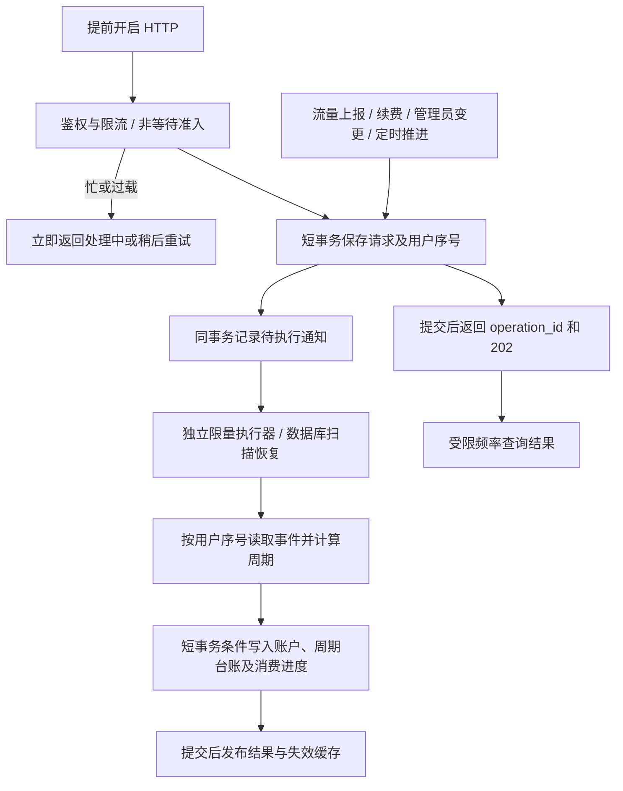

# 套餐流量周期修复与并发隔离设计

日期：2026-11-05（Asia/Shanghai）  
审查基线：`cf03c375a3e4c538c057a3a485f9fec83bf30767`  
状态：设计方案，尚未实现、压测或部署。本文记录推荐实现及发布门槛，不代表这些保证已经存在。

修订说明（2026-11-05）：按用户明确的业务语义，提前开启会结束旧周期并作废其剩余时间，从操作逻辑生效时点进入下一完整已购周期；原稿“保留到期时间、只跳过原重置日”的规则已撤销。以下周期、排期、折抵与验收应共同遵循这一修订。

## 1. 设计结论与约束

修复需要同时统一自然周期、记录已提前使用的权益，并限制数据库竞争的影响范围。仅修改 31 天判断、增加 `lockForUpdate()`、使用 Redis 锁或把任务放进普通队列，都不足以完成修复。

本方案采用：**HTTP 可靠受理后返回 + 独立且有并发上限的后台执行器 + 每用户有序事件 + 短事务条件更新 + 周期权益台账**。保留 `v2_user.u/d` 作为本阶段对外读取的已结算计数，避免立即改造所有节点和订阅读取；清零和入账的写入口必须统一。周期信息另表保存，期限缩短、未来排期调整和权益切换必须同事务完成，不能只改 `expired_at` 并让它隐式决定重置日。

这比前一轮讨论中的同步条件更新多了一层异步受理。原因是用户提出了明确的资源隔离要求：即使旧代码暂时持有账户写锁，也不让点击提前开启的 HTTP 请求等待该账户锁。

| 用户要求 | 实现约束 | 可以承诺的边界 |
| --- | --- | --- |
| 一个请求锁住账户记录，事务迟迟不结束 | 提前开启 HTTP 不更新/锁定账户；后台事务只执行必要 SQL，事务内禁止网络、Redis、通知、休眠和队列等待 | 新增 HTTP 处理不持有账户写锁；数据库自身故障仍可能延长后台执行，必须有运行监测和隔离 |
| 大量并发争抢同一记录、等待释放 | 网关限流、同用户非等待准入、单个待处理动作、每用户顺序执行，CAS 和唯一键处理少量失效重入 | 正常情况下同用户只有一个执行者；准入失效时数据库约束仍保证最多一次生效 |
| 等待占用数据库连接/PHP 进程，拖垮全站 | HTTP 不同步等执行结果；执行器进程、数据库连接、受理并发和队列容量分别设硬上限，冲突不在请求内重试 | 新功能可占用的资源有预算；不能把“数据库写入完全不等待”或“任何故障全站都不受影响”当作保证 |

**不采用显式账户 `SELECT ... FOR UPDATE` 作为本功能的正常处理流程。** `UPDATE`、唯一约束检查、序列头更新仍会使用 InnoDB 内部锁；方案目标是缩短持锁、减少竞争、快速退出和限制故障影响，不是宣称完全无锁。

当前仓库目标包含 MySQL 5.7；不得把 MySQL 8 的 `NOWAIT` / `SKIP LOCKED` 当作实现前提。线上版本、存储引擎、连接复用和部署实例数量需要上线前核实。

## 2. 已核实的缺陷与修改范围

### 2.1 日期与业务链路

| 编号 | 代码证据 | 问题 |
| --- | --- | --- |
| D01 | [UserController::newPeriod](../../app/Http/Controllers/V1/User/UserController.php#L90)、[UserService::getResetPeriod](../../app/Services/UserService.php#L104) | 月度资格使用严格 `剩余秒数 > 31 × 86400`；截图在 2026-11-05 当天无法满足 |
| D02 | [newPeriod 更新](../../app/Http/Controllers/V1/User/UserController.php#L130)、[按到期日重置](../../app/Console/Commands/ResetTraffic.php#L154) | 提前开启减去倒计时天数，0 又变成固定 30 天；到期时间同时是重置锚点，扣减会使锚点漂移；无提前消费记录 |
| D03 | [展示算法](../../app/Services/UserService.php#L15) | 月首倒计时少一天；跨短月未统一裁剪；可能展示到期前根本不会发生的重置 |
| D04 | [手动续费](../../app/Services/OrderService.php#L565)、[自动续费](../../app/Console/Commands/CheckRenewal.php#L115) | 两份 `strtotime('+N month')`，月末溢出；自动续费绕过普通订单开通逻辑 |
| D05 | [年度重置](../../app/Console/Commands/ResetTraffic.php#L61) | 继承全局年首规则的 `case 3` 缺少 `break`；2 月 29 日周年在平年展示和执行不一致 |
| D06 | [按到期日重置限制](../../app/Console/Commands/ResetTraffic.php#L162) | 固定距到期超过 25 天才清零，与展示及实际自然周期不是一套规则 |
| D07 | [续费清零](../../app/Services/OrderService.php#L534) | 只比较到期月日和当天月日，会越过提前消费状态；自动续费又不走同一分支 |
| D08 | [换套餐折抵](../../app/Services/OrderService.php#L206) | 根据到期时间、固定月份秒数及当前流量估值，不识别提前进入、时间作废和未来排期变化；必须同步修复 |

截图与“按每月到期日重置”相符，线上实际套餐规则和全局规则仍需读取配置核实。续费前显示“1 日后”不证明届时会清零：该边界可能恰好等于到期时间，而任务排除了已到期用户。

### 2.2 并发与流量链路

| 编号 | 代码证据 | 问题 |
| --- | --- | --- |
| C01 | [newPeriod 事务](../../app/Http/Controllers/V1/User/UserController.php#L95) | 普通读后更新，无版本或周期幂等记录；事务本身不能防止重复消费 |
| C02 | [TrafficUpdate](../../app/Console/Commands/TrafficUpdate.php#L44) | 开始时检查一次 Redis 标记不是互斥；读取旧 `u/d` 后绝对值回写，可能覆盖清零 |
| C03 | [Redis 批次提取](../../app/Console/Commands/TrafficUpdate.php#L47) | `HGETALL` 后 `DEL` 非原子；期间增量可能丢失；数据库失败时缓存已删除；只按下载键遍历也有漏账风险 |
| C04 | [TrafficFetchJob](../../app/Jobs/TrafficFetchJob.php#L40) | 逐用户、逐方向累加，任务部分成功再重试可能重复计数；现有上报未携带可靠的来源幂等身份 |
| C05 | [账户余额锁](../../app/Services/UserService.php#L202)、[佣金划转](../../app/Http/Controllers/V1/User/UserController.php#L419) | 已有其他路径可能锁住同一账户；佣金划转在提交前调用通知，不应让外部发送延长事务 |
| C06 | [队列默认值](../../config/queue.php#L16)、[Horizon](../../config/horizon.php) | 未配置时默认 `sync`；现有业务队列多进程消费，不能把 `dispatch()` 等同于异步或每用户串行 |

审查不是线上事故取证。以上为代码路径和日期计算问题，尚未据此断言生产已经发生锁拥堵。

## 3. 周期业务规则

### 3.1 独立保存期限、锚点和权益

- `expired_at` 表示当前实际服务截止；提前开启会精确扣除旧周期尚未结束的时间。
- 保存购买基准规则、原始重置锚点、续费锚点、原始权益 ID、基准有效期、累计前移量和排期版本。实际排期不能从修改后的 `expired_at` 日号重新推导。
- 购买基准按自然月/年计算：31 日在短月裁到月末，后续恢复 31 日；2 月 29 日周年在平年裁到 2 月 28 日，闰年恢复。每个基准边界从原始锚点独立计算，不从上次裁剪后的日期继续加月。
- 提前开启后保留每个已购完整周期原本的实际时长，所有尚未生效的未来边界共同前移；**不从操作时点重新加一个自然月**。这两种月末算法并不等价，用户已明确选择前者。
- 实际周期用半开区间 `[B, E)` 表示。原始权益边界与调整后的实际边界都保存，已结束历史不回写，避免对账时丢失作废及前移证据。

例如用户已确认：原下一周期为 `2027-01-31 00:00 → 2027-02-28 00:00`，实际长度 28 天；在 `2027-01-30 00:00` 提前开启，旧周期剩余 1 天作废，新周期为 `2027-01-30 00:00 → 2027-02-27 00:00`。不会改成 2 月 28 日，也不使用固定 30 天。

这里的“完整周期”指完整保留**已经购买的下一周期实际长度与配额**，不承诺调整后的日期仍是每月同日。即使套餐基准为每月 1 日/每年 1 月 1 日，选择提前开启后，该用户未来按调整后的个人排期执行；套餐及其他用户的基准规则不变。预览必须展示这一变化，不能同时继续声称该用户下次仍按原月首/年首清零。

续费在未前移的购买基准时间线上扩展权益，再转换到当前实际时间线；续费锚点与重置锚点在月首模式下可能不同，不能合成一个日号。首次迁移无法证明历史原始锚点时，以当前可见日期初始化并标记历史未知，不猜测恢复成 31 日。

### 3.2 提前开启的资格

本方案采用**作废当前周期剩余时间，提前进入最近一个已购完整周期**的规则：

1. 功能开启，用户有有效的循环套餐，且按事件顺序结算到该动作时当前周期流量已耗尽。
2. 取得当前实际排期中的下一个未激活已购权益 `[B, E)`；只能取紧邻下一周期，不跳过中间周期或退款/撤销的权益。
3. 令动作逻辑生效时点为 `T`，旧到期为 `X`；要求 `T < B < E <= X`，且该完整权益实际已购、未消费。不再使用固定 31 天判断。
4. 计算精确时差 `Δ = B - T`，以实际时间戳计算，不用展示用的 `reset_day`，也不取整成天。
5. 当前周期在 T 结束并封存，`[T,B)` 的剩余服务时间作废；下一权益立即激活，新区间为 `[T, E-Δ)`。
6. 其后所有已购未来起止边界及到期时间共同前移 Δ，即 `X' = X - Δ`。参与前移的已购权益数量、各周期长度、各周期配额和已付尾段长度都不增加、不减少；其中第一个从待激活变为当前激活，其余继续待激活；仅旧当前周期的剩余时间作废。
7. 同一短事务更新 `expired_at`、排期版本、权益激活、`u/d=0`、epoch、效果和消费进度。旧版本定时任务作废，不再按旧排期清零或推进新排期的周期游标；若已进入事件序列，仍需按序记录失效结果并推进事件消费序号。

因为 `E <= X`，可推导 `E-Δ <= X-Δ`；因为 `E > B`，新周期长度 `(E-Δ)-T = E-B > 0`，且新期限必然晚于 T。这个不变量比“剩余大于某个固定天数”准确，也避免从 T 重新加月后裁剪月份改变已购时长。

月首规则下只覆盖未来月份一部分的订阅不能提前领取完整周期，但已购尾段不能因调整被静默删除；它与完整周期一起平移，权益类型和原配额规则保持不变，禁止把尾段变成额外完整周期。普通边界发放资格除时间条件外，还必须有对应未激活权益，不能只凭 `边界 < expired_at` 增发次数。

每次请求绑定受理时看到的 `generation`、`epoch`、排期版本和目标权益 ID。不同幂等键但来源于同一旧状态的并发点击，最多一个成功；第二个不能自动改为消费再下一个周期。成功后只有再次真实耗尽、刷新状态并发起新动作，才允许再次提前进入后续完整周期；每次只作废当时当前周期的剩余时间，不重复扣减此前已作废时间。

### 3.3 时间计算与用户案例

以精确时刻为准，例如 T 为 `2026-11-05 00:00`：

| 动作/时间 | 结果 |
| --- | --- |
| 到期为 2026-11-06 00:00，流量耗尽 | 没有完整已购下一周期，不能提前开启 |
| 续费一个月 | 到期为 2026-12-06 00:00，通常续费不自行清零 |
| 在 11-05 00:00 开启原 `[11-06 00:00, 12-06 00:00)` | Δ 为 1 天，旧剩余时间作废；新周期为 `[11-05 00:00, 12-05 00:00)`，到期缩为 12-05 00:00 |
| 旧重置日 11-06 00:00 | 旧排期已失效，不清零，保留新周期已用流量 |
| 只有这一个未来完整周期 | 新周期末即到期；到期前不再有一次配额清零 |
| 仍有多个完整未来周期 | 新下一次清零为原 E-Δ；后续边界共同前移，而非在原 B 再发一次 |
| 还差 3 天才重置时开启 | 原截止和所有未来边界精确前移 3 天；若不足整天则按实际秒差计算 |

操作时分秒也不能丢弃：若 T 为 `2026-11-05 12:00`、B 为 `11-06 00:00`，则 Δ 仅 12 小时，新到期为 `12-05 12:00`，不能因界面显示“1 日后”就扣整整一天。

多周期例如 T=`2026-11-03 00:00`、未来完整周期为 `[11-06,12-06)`、`[12-06,2027-01-06)`，Δ 为 3 天；调整后依次为 `[11-03,12-03)`、`[12-03,2027-01-03)`，新到期为 01-03。两个周期原本分别 30/31 天，调整后仍分别 30/31 天。若还有已购部分尾段，尾段起止与截止同减 3 天，不丢尾段、不增加配额次数。

“旧边界失效”指旧排期版本失效，不是永久屏蔽某个时间戳。例如原 B=`2027-02-28`、E=`2027-03-28`，T=`2027-01-31`，前移 28 天后新 E 恰好仍为 `02-28`。如果还购买了后续权益，这个时刻应按新排期正常进入后续周期一次；旧任务不能执行，新任务不能被旧日期黑名单误拦。若此时恰好已经到期则不发放。

### 3.4 续费基准、年度与任意时刻执行

累计前移量 O 作用于尚未生效的未来购买基准边界，实际边界为 `基准边界 - O`。每次提前成功增加 Δ 并保存新的排期分段与版本；过去已发生的历史不套用最新 O 回写。未提前时 O=0，正常月首/到期日/周年规则按购买基准执行。

后续续费继续使用保存的购买基准、续费锚点及基准到期时间，新增自然月/年权益后再减当前 O；不能直接从调整后的 `expired_at` 日号重新建立自然月规则。例如基准 01-31→02-28，提前 1 天后实际到期 02-27；续费一个基准月，基准结束为 03-31，减 1 天后实际结束为 03-30。新增周期保留原基准 02-28→03-31 的 31 天，不能变成对 02-27 直接加月得到 03-27。预览和续费确认展示实际起止及天数，避免将其误描述为“此后每月 27 日”。

年度规则也按同样逻辑：先用原年度基准处理闰日并确定已购周期实际秒长，再精确平移；不能固定减 365 天，也不能提前后每次从新日期重新加年改变旧权益长度。固定月首/年首只作为购买基准，不会越过该用户的排期版本重新发放。

提前后实际边界可落在任意时分秒，原 `daily()` 午夜重置无法执行这些边界。改为按有索引的 `next_reset_at` 扫描到期状态，例如每分钟唤醒，并在每个流量/权益事件前做应到边界推进；账务按精确边界排序，实际数据库投影及节点同步存在调度延迟，不承诺秒级即时可用。展示不能把新边界截回午夜。

T 采用第 7 节的持久受理排序时点，是逻辑生效时点；数据库成功提交及节点收到新状态晚于 T，不能把 HTTP 202 描述为额度立即可用。提前请求采用短有效期和延迟监控，过旧则拒绝、全量不变；若要求周期必须从额度实际可用时刻起算，需要另行设计生效屏障，不能把当前异步方案静默解释成那种语义。

### 3.5 其他权益变更与折抵

| 操作 | 必须遵循的行为 |
| --- | --- |
| 同套餐手动/自动续费 | 共用购买基准和生效路径；新增权益转换为实际排期后延长期限，不撤销已作废时间；删除绕过状态机的月日相同直接清零 |
| 新购、到期后重新购买 | 明确新订阅代次及初始配额；过期旧周期不得被新代次误用 |
| 重置包 | 独立付费配额事件，清零一次；不返还或取消已提前消费的周期，不额外占用未来周期 |
| 换套餐、一次性与循环互转、礼品卡改套餐 | 在同一状态变更中结束旧代次并建立新代次；旧权益、折抵和新配额一次结算 |
| 管理员改到期或重置方式、全局方式调整 | 进入统一变更服务，做版本校验；说明受影响权益；禁止直接改字段导致静默重新发放 |
| 不重置或永久订阅 | 无自然未来周期可提前领取；不伪造固定天数 |

**折抵与退款是上线前置条件。** 已提前领取的权益不能继续按“未来未使用月份”全额折抵。本稿提出以下可验证计价规则；这是需要与现有销售规则核对的建议规则，不是对旧合同的追溯改写：

- 每笔新购/续费权益的可分配价值为该笔新增实付及明确核销转入的旧权益价值，扣除退款；折扣不形成未支付价值。转入价值保留原来源并从旧账原子核销，不能在新旧订单各算一份。
- 以这笔订单新增覆盖的购买基准服务区间与各基准自然周期的交集秒数为权重分配价值。金额以分计，按确定性最大余数分配尾差，分配总和等于该笔可分配价值；部分首末周期也有独立分配记录。后续平移保持权益 ID 和来源金额，不因重算日期重复分配价值。
- 未激活、尚未开始的权益价值可全额计入折抵。已激活周期的建议可折抵额为 `floor(周期分配价值 × min(剩余时间比例, 剩余配额比例))`；两个比例均裁剪到 `[0,1]`。时间比例使用激活后的实际区间 `[T,E-Δ)`，不再使用已经失效的旧 `[B,E)`；配额比例使用该权益从激活以来的累计消耗，不能用新一轮被清零后的账户计数替代。
- 旧当前周期在提前开启时封存其消耗及剩余时间作废结果，不再恢复对应服务或折抵价值；下一周期成为新的计数归属。再一次提前开启时同样封存，禁止因 `u/d=0` 把此前耗尽或作废的周期重新算成未使用。
- 折抵、退款及其重复请求必须原子核销来源权益；新套餐只能得到这次核销转入的价值。同一价值不能重复折抵或退款。

例如某来源已付 20000 分，分配为两个各 10000 分的完整周期：第一个已耗尽，第二个被提前开启并耗尽，即使调整后到期仍在未来，二者可折抵额均为 0。随后换套餐、再次换套餐均不得重新产生这 20000 分的价值。若第二个激活后仅剩 25% 配额，其建议可折抵额最多为 2500 分；若实际剩余时间比例更低则还应降低，不能因为旧 B 还没到就把时间比例固定为 1。第一周期作废的剩余时间不会复活。不同月份按秒分配额可以不同，不能将示例均分当成通用规则。

当前仓库没有完整历史权益账本，不能直接承诺可精确回算所有历史订单。实施时必须固化计价规则和示例；对无法完成精确估值的历史账户，先拒绝自助自动折抵并提供人工核对路径，不能继续套用旧公式。若这一兼容策略无法接受，则相关账户暂不开启新提前领取功能，直到完成估值兼容。

## 4. 推荐架构与数据边界

请求受理数据库事务与账户更新事务是两件事，绝不跨越排队过程。所有 Redis 或外部调用均在数据库事务之外。可靠执行以数据库中的待处理事件为依据，Redis/Horizon 只用于唤醒、调度与削峰；消息通知丢失后，扫描器仍可找到待处理数据。

普通订阅、节点列表等读取继续读已结算状态，不必获取用户级互斥；展示附带已结算版本和处理中状态。队列积压时显示状态延迟并告警，不伪报完成。额度耗尽和封禁等现有授权检查不能因为存在 pending 动作而放宽。

### 4.1 建议新增数据

以下是逻辑模型，最终 DDL 需结合 MySQL 5.7 的索引长度、升级兼容、数据规模和执行计划确定。

| 表/字段 | 职责与关键约束 |
| --- | --- |
| `v2_traffic_inbox_head` | 每用户一行，仅受理阶段使用；保存递增序号、排序时间及最近提前动作 ID；主键 `user_id`；执行器不持有此行等待账户写入 |
| `v2_traffic_event` | 持久接收事件，包含 `user_id`、`seq`、`event_id`、类型、载荷摘要、受理时间、来源；唯一 `(user_id, seq)` 和来源幂等身份 |
| `v2_traffic_operation` | 动作 ID、用户幂等键、请求摘要、预期代次/epoch/排期版本/目标权益 ID、状态、结果；唯一 `(user_id, idempotency_key)`；结果必须持久化后才能宣告成功 |
| `v2_traffic_period_state` | 订阅代次、规则版本、购买基准锚点/基准截止、累计前移量、排期版本、当前有效起止/下一边界、计数 epoch、执行版本和 `last_applied_seq`；主键 `user_id` |
| `v2_traffic_period_claim` | 稳定已购周期权益 ID、来源订单、原始起止、激活起止、累计消耗及状态；唯一 `(user_id, generation, entitlement_id)`，不以会移动的边界充当权益身份 |
| `v2_traffic_schedule_change` | 唯一变更事件、前后排期版本、逻辑生效时点、原剩余时间、期限与未来边界调整明细；旧排期保留作历史证据，不能覆盖成新排期 |
| `v2_traffic_effect` | 事件的应用结果、计数/权益/期限变化和作废原因，唯一事件 ID；用于审计、对账和结果查询 |
| `v2_traffic_outbox` | 与受理/生效同事务写入的待发布通知；提交后发送，重复发送安全 |
| `v2_user.quota_revision` | 对套餐、期限、额度、`u/d` 等相关写入递增，供账户条件更新使用；不让所有普通流量写入与余额变更共用无意义的业务版本冲突 |

事件序号由受理事务更新该用户的序列头后分配，随事件一并提交；禁止仅按自增 ID、客户端时间或 Redis 列表顺序推断数据库提交顺序。序列头会产生很短的隐式写锁竞争，由准入、单用户限制和超时控制；它不与余额、密码、账户写入共用一行。

序列头中的最近动作 ID 不作为永久忙标志：新受理在取得头部写入权后，普通读取其指向的操作终态；已完成/拒绝/取消则可用新操作替换，仍在处理或结果未知则不受理第二个动作。执行事务只更新操作结果，不回写序列头。清理器如需移除旧引用，必须以旧操作 ID 为条件单独清理，不能清掉后来的引用。客户端退出和 worker 崩溃不能造成永久忙；扫描器应定位长时间 pending 并恢复或有序终结。

受理表不添加指向账户行、会让写入前检查账户记录的外键；身份与存在性由鉴权和业务校验保证。若最终采用外键，必须重新验证其锁行为，不能继续宣称受理阶段与账户锁隔离。

未来边界整体前移采用“不可变购买基准 + 当前前移量 + 游标/排期版本”惰性计算；生效事务只写有限状态和变更流水，不遍历更新未来所有周期。否则长年订阅或重复提前会把本来很小的操作变成长事务，违背本方案资源约束。

## 5. HTTP 受理、幂等与容量控制

### 5.1 非等待准入

鉴权后，通过一次有界的 Redis 调用尝试取得用户级受理许可，使用随机 token 与短 TTL；忙时立即返回，禁止 `block()`、轮询抢锁、`sleep()` 和同步重试。释放时比较 token，禁止直接 `DEL` 删除可能属于新请求的许可。Redis 失败时关闭这类变更入口并返回可重试错误，不能绕过准入直冲数据库。

Redis 许可只降低竞争：过期、网络暂停或主从切换都可能使多个请求同时通过。数据库幂等键、版本和唯一约束仍是最终保证。Lua 必须只处理少量固定键，禁止扫描所有用户；Redis Cluster 部署还要确保相关键的脚本兼容性。

这里的“数据库前”指业务写入前。现有认证可能已经读取数据库，不能声称整条请求完全不使用数据库连接。网关并发上限必须在 PHP 处理和认证前生效，并保护整个入口资源预算。

### 5.2 受理事务

1. 普通读取幂等结果；同一键、同一摘要返回原操作，同一键不同内容返回冲突。
2. 计算并校验请求的格式、大小和目标状态提示；真正的流量耗尽及权益资格由执行器按事件顺序再次判断。
3. 开启专用短事务：按用户主键条件更新序列头，确认没有另一个待处理提前动作；分配序号；写入操作、事件和 outbox；提交。
4. 返回 `202 Accepted`、`operation_id` 和状态查询地址；这只表示已持久受理。
5. 发布唤醒消息失败不撤销已受理结果，交由 outbox/扫描器恢复。

受理阶段必须使用**独立受理连接**，在连接建立/借出时设置经验证的短 session 锁等待，并有独立连接数、连接/网络超时及事务清理策略。仅限制执行器连接不够：序列头或唯一索引被阻塞时，受理请求也必须有界退出，不能使用数据库默认长等待耗尽 PHP 进程。

同一用户最多一个待处理提前动作。状态查询必须校验归属、限频并可缓存；前端使用退避，不进行紧密轮询。浏览器超时后使用原幂等键查询/重试，不能自动换新键。

新接口建议采用显式版本，避免旧主题将 `202` 当作业务成功。原 `/api/v1/user/newPeriod` 不得静默改成异步却仍返回 `data: true`。页面需支持“处理中、完成、业务拒绝、需重试/人工处理”，并在成功后重新拉取订阅状态。仓库中未确认存在截图主题的可维护源代码；找到并升级实际主题是发布前置条件，不能直接编辑压缩产物作为完整交付。

### 5.3 容量与超时预算

以下是**首轮压测起点，不是已验证的线上参数或硬实时保证**：

| 项目 | 初始预算/要求 |
| --- | --- |
| 同用户待处理提前动作 | 1；重复请求返回既有操作或忙状态 |
| 受理 HTTP 同时执行数 | 部署总体先按 4 限制；过载直接 429/503，不在 PHP 内排队 |
| 周期执行器 | 独立 supervisor，总体最多 4 个进程；同用户调度只允许一个活跃执行者 |
| 单次账户变更 | 默认单用户、单事件事务；相邻纯流量增量可做有数量和时间上限的小批次，不跨清零/权益事件合并 |
| 正常受理延迟 | 参考目标 P99 < 300 ms；故障快速退出另测，不用数据库超时冒充此目标 |
| 正常账户写事务 | 参考目标 P99 < 50 ms；发现 > 200 ms 的事务记录告警，不能靠事务内主动 sleep 控制 |
| InnoDB 记录锁等待 | 专用连接可从会话级 1 秒开始测试；超时后回滚全部事务 |
| 待执行队列与事件存储 | 预先配置最大待处理数、最老事件年龄和存储水位；阈值依据实测吞吐与恢复时间确定，不允许无限接受 |
| 单动作过旧 | 提前动作在超过配置有效期后拒绝执行并持久化结果；到期请求不得在很久以后意外清零 |

所有进程和连接上限按**整个部署**计算，包含多实例、滚动发布重叠、扫描器和 outbox。Redis 信号量不能代替进程/连接硬上限。专用业务数据库账号应配置连接预算；预留网站认证、查询、支付等资源和数据库管理余量。线上不能直接照搬上表数字，应根据容量填写实际预算并做故障压测。

落地时固定“允许副本数 × 每副本并发/连接数”，滚动发布的 `maxSurge` 与退出中的旧进程计入同一预算；分别限制受理 PHP 池/路由并发、执行器、扫描器和 outbox。数据库侧通过独立账号的 `MAX_USER_CONNECTIONS` 等经验证的限制兜底，确认代理/连接池没有绕过预算。容量配额按分片或部署预算原子预留/释放，并定期对账；禁止各请求先 `COUNT` 再自行判断。容量不足不能确认流量已收到或订单已开通；已到账支付仍须独立可靠留存并标记待处理。

MySQL `innodb_lock_wait_timeout` 只限制相关记录锁等待，不是整个事务或 HTTP 请求的耗时上限；死锁、元数据锁、网络读写、磁盘和提交等待需要分别处理。专用连接的 session 参数在连接建立/借出时设定，异常时显式全事务回滚，复用前恢复或丢弃连接；Webman/长驻 worker 尤其不能把错误事务或 session 设置泄漏给后续请求。若配置元数据锁超时，也须按真实版本单独验证。

不要通过无限增加 Horizon 进程解决积压，不要让该队列继承现有最高 128 个业务进程的自动伸缩。必须显式使用 Redis 异步连接并启动检查，发现 `sync` 或消费者未启动时拒绝开启新功能。

## 6. 后台执行与数据库事务协议

### 6.1 每用户顺序与并发失效保护

调度可按用户哈希分片，但正确性依靠用户序号及数据库状态，不依靠“同一队列天然 FIFO”。多进程消费、任务重试、worker 崩溃或 Redis 许可失效时，都只允许应用 `last_applied_seq + 1`。缺号应暂停该用户并恢复，禁止跳过未确定结果的事件继续执行后续清零。

读取下一事件及状态后，在事务外做自然日期、权益和结果计算。提前开启同时核对 `generation + schedule_version + epoch + entitlement_id` 以及账户版本；进入短事务后，按账户 `id + quota_revision` 更新期限及相关字段，再按周期状态版本和 `last_applied_seq` 做条件更新。受影响行数不是 1，则整个事务回滚；旧计算不得提交。每次成功把期限扣减、前移量、排期版本、当前权益封存/下一权益激活、清零、epoch、事件效果、操作结果和 outbox 一起提交。不得先缩期后另行清零，或清零后再尝试缩期。所有写入成功后才向外报告完成。

正常路径不先显式锁账户。即使两个执行者误处理同一事件，账户版本、周期状态条件以及唯一效果记录必须让其中最多一个事务提交；另一个全部回滚，不能在同一事务中忽略重复错误后继续清零。

### 6.2 固定顺序与事务禁区

- 受理事务只写序列头、请求/事件/outbox，不写账户和执行状态；执行事务不占用受理序列头。
- 生效事务统一按“账户 → 周期状态 → 周期权益/效果 → 操作结果/outbox”顺序写入。必要的多账户业务必须单独证明锁顺序，不塞进本流程。
- 所有行按主键/唯一索引精确访问；上线前验证执行计划。批量遍历在事务外分页，不开覆盖整批用户的长事务。
- 事务内禁止 Redis 操作、Telegram/邮件/支付通知、HTTP、队列投递等待、休眠和大范围统计查询。通知通过 outbox 提交后发送。
- 失败、超时、死锁及任意 `Throwable` 均显式回滚；进程终止后清理连接；提交结果未知时先查事件效果，不盲目重新执行。

MySQL 5.7 的记录锁超时默认可能只回滚当前语句，因此不能捕获异常后继续使用原事务。账户更新后再等待另一行仍会持有先前锁，CAS 和唯一索引也不能消除这种可能性；固定顺序、单事件小事务和有界执行器缺一不可。

### 6.3 冲突、失败和重试

| 情况 | 处理 |
| --- | --- |
| 已处理的事件/同一操作重试 | 返回持久结果，不再清零或新增权益 |
| 旧 epoch、旧代次、旧排期版本或目标权益已经激活 | 业务拒绝；不能自动消费更远周期，也不能再次扣除 Δ |
| 版本冲突 | 全部回滚，重新读状态；交回调度器有限重试，不在 HTTP 或持连接时循环 |
| 死锁/记录锁等待超时 | 全部回滚、释放连接；延迟调度并加抖动；连续失败熔断该用户/执行通道并告警 |
| COMMIT 后断线、结果未知 | 使用独立普通查询确认唯一事件效果；未确认前保持“处理中/待核实”，不把未知当失败重做 |
| worker 在提交前崩溃 | 回滚后仍有未应用事件，恢复后重播 |
| worker 提交后、通知前崩溃 | 事件效果和消费进度已提交；扫描/outbox 恢复通知，不能重复应用 |
| 永久业务拒绝 | 持久化拒绝结果并有序推进消费位置；不阻塞该用户所有后续事件 |
| 载荷损坏或无法证明的序列缺失 | 隔离该用户、停止跳序，告警人工恢复；不得自动丢弃流量事件 |

记录持久错误次数和 `next_attempt_at`，达到上限转人工待处理，不无限制造新 job。延迟期间没有开启的事务；长驻进程可能保留空闲连接，必须计入连接预算，必要时归还/断开。

## 7. 可靠流量入账与周期边界

### 7.1 权威接收与去重

完整方案把流量增量写入同一用户持久事件序列，服务端成功确认前必须落入可靠存储。Horizon 调度与统计不是权威入账凭证。后台按事件顺序更新 `u/d` 和消费位置，失败可重播，不能先删除缓存再尝试写库。

节点增强协议使用稳定 `(node_type, node_id, source_instance, report_id)`，同一报告内再以用户/分段号拆分；节点类型不可省略，不同类型的节点 ID 可能相同。`report_id` 应持久递增或具有同等唯一性；重启后重传未确认旧报告必须保留原 instance/report ID，新实例身份只用于新报告。

分段受理协议固定如下：

1. 首个有界事务创建报告收据，保存完整载荷摘要、可恢复的有界原始载荷、固定分段方案、节点倍率/计费规则版本和进度；同身份不同载荷报冲突。报告大小和最大用户数由接口预先限制，不能把任意大报告直接塞进事务。
2. 每段用稳定来源身份及段号/用户号，与其用户序号和事件同事务保存；重传沿用原计费规则。保存原始字节量与计费量，固定整数舍入和溢出检查，不能因倍率改动让重试结果变化。
3. 并发重传、部分完成或崩溃恢复均查原收据，只补未完成段。已受理段可以提前执行，不能要求整个报告原子回滚；每用户的排序时点是该段取得用户序号的时点，不是整份 HTTP 到达时点。
4. 全部段持久化并校验完成后封口，才能确认整份报告完成。超过单请求执行预算则保留可恢复半成品、返回原报告的可重试状态；恢复任务有界补全，并对长期未完成报告告警，禁止删除半成品以掩盖错误。
5. 去重收据至少保留来源最大重试/重放窗口；清理之后的旧 ID 必须有可验证的拒绝策略或累计水位，不能清理后把重传当新流量。人工恢复也保留来源身份和段号。

禁止在事务内锁住所有用户账户，也不按任意大报告开启单个事务。节点受理入口需要独立的请求并发、报告规模、分段数量和数据库预算，不能为了可靠入账引入另一条无界 HTTP 循环。若将来改为整份报告存储后即确认、再后台分发，必须重新明确接收排序与完整恢复语义，不能与上述分段封口协议混用。

旧协议没有稳定 report ID 时，只能保证**同一个服务端已接收事件**内部重试不会重复生效，不能保证 ACK 丢失后的来源重传去重。不得用流量内容哈希代替 report ID，两次合法报告可以内容相同。兼容接口需明确此限制；声称端到端不重复前必须完成节点协议配合。

事件量、请求体、每报告用户数和单用户积压有明确上限。触及阈值返回可重试错误并依靠节点可靠保留重传，不能接受后丢弃。节点不具备保留/重传能力时，上线前需要升级或接受并记录故障期间数据缺失风险，不能无条件承诺零丢失。

### 7.2 先明确时间归属

本阶段默认采用**服务端持久接收排序**，不是用户真实使用时间：同用户序列决定先后，执行时先推进应当在事件排序时点之前发生的日历边界，再应用该事件。时点恰好等于边界时，先推进边界，再处理流量/业务动作。

排序时间的取得方式固定为：受理事务先通过精确主键写操作实际取得该用户序列头的写入权，再用**后续独立语句**读取数据库 UTC 时间，取 `max(当前数据库时间, 该用户上次排序时间)`，连同新序号写入头部与事件，一起提交。不能在请求到达、事务开始或等待头部锁的同一语句开始时提前取 `NOW()`，否则跨日等待可能导致顺序时间倒退。时钟回拨/异常跳变告警并暂停有风险的时间敏感动作；序号决定同一时点的先后。

只有提交成功才称可靠受理，但业务排序采用上述序列分配时点：若该时点在 B 前、提交在 B 后，仍按 B 前事件处理。这是本方案明确选择的语义，不把预提交时间伪称为实际提交时刻。若要求以真实使用时刻或提交完成时刻决定跨界，需要另行修改协议。

提前请求在边界前可靠受理、正常时限内执行，按其受理位置判断；过旧请求按第 5 节拒绝，后续事件不能被越序应用。实际完成以数据库成功提交为准；保存 T、事务内应用登记时间和提交确认记录以解释延迟，不能把提交前登记时间伪称为精确的物理提交时刻。COMMIT 断线时确认记录可以暂缺，依靠唯一效果恢复核实。

提前成功在 T 逻辑关闭旧周期并激活下一权益，epoch 递增一次；旧排期任务不再递增或清零。后续新排期实际激活下一个权益时才再次递增。流量事件最终归属由该有序执行结果确定，接口侧不能按当前缓存 epoch 擅自标记；T 之后受理、实际提交前到达的后续报告，也必须在提前动作之后按序结算。迟到报告按接收位置计入，不能承诺自动拆分真实跨界用量。

数据库提交确认时点 C 晚于 T，节点真正可用还取决于其状态同步；不能把 C 当作节点已恢复的精确时刻。超过提前操作的有效期或执行时新截止已过去时，应持久拒绝且期限/用量/排期均不变，不能改用 worker 当前时刻重算 T 后悄悄成功。提交结果未知时核实原效果，不得用新的 T 或再次扣 Δ 重做。

如果产品要求按实际使用时间归属，则需额外支持来源报告 ID、采集区间/累计水位及边界分段，处理乱序、迟到和撤销；这是节点协议工作，不用服务端猜测代替。

### 7.3 正常定时推进和停机恢复

定时器按有索引的精确 `next_reset_at` 查候选，只通过**同一个用户序列头**提交有序唤醒/推进事件，不直接批量 `u=d=0`。执行器处理任意事件前，依据当时有效排期和受理排序时点生成应到边界；空闲用户也由带索引的扫描器走同一受理协议唤醒。旧版本候选只作为提示，执行时重新校验当前排期。

禁止扫描器发现“已提交事件暂时为空”就直接按墙钟推进 B：可能存在已经取得序列头、排序时间 T<B、尚未提交的提前动作；直接推进会抢在该动作之前清零。定时事件必须等同一序列头确定顺序后再处理。T 与 B 同秒时先处理到达边界，再校验提前请求旧 epoch，禁止产生 0 或负数 Δ。

派生边界效果绑定稳定权益 ID/序号和排期版本，不能仅以时间戳去重；同一权益激活唯一约束保证前移后不会再领一次。边界游标、状态版本、唯一效果和账户变更同事务提交；全部应到边界处理完成前，不推进正在等待的来源事件 `last_applied_seq`。跨多个边界分事务时，每次只推进已完成的游标，崩溃后从该处恢复。旧版本载荷不能修改新排期的周期游标；已经进入用户事件序列的失效任务，仍须按序持久化为 no-op 并推进 `last_applied_seq`，否则后续流量/续费会被永久阻塞。通用的事件前置推进仍可依据当前有效排期处理应到的新边界，不能依据旧任务载荷推进。新版本边界即使恰好落在旧边界同一时间也应正常判定。扫描器唤醒应合并且有界。

回放依据历史事件到该边界时的规则、代次、排期、权益状态和期限判断，有对应未激活权益且 `B < 当时有效的 expired_at` 才发放，恰好相等不发放。不得用 worker 当前时间、最新前移量或未来续费后的期限追溯改变旧边界；当前执行时间只用于动作过旧拒绝等明确的执行保护。

新系统完整事件序列覆盖的时间内，恢复时按排期变更、有效边界和已接收流量顺序回放：提前时只激活一次权益并精确作废旧剩余时间；旧版本任务失效，新版本后续边界按权益清零一次，再应用其后的流量。不能先累加全部流量、再按重启当天补做清零，否则会擦掉当前周期已用量。多个逾期边界分次处理，单事务数量有界。

对旧系统没有流量明细的停机窗口，无法精确回放。保留快照并标记待核对，不能按当前日期无条件补清零后宣称完整恢复。

### 7.4 过渡期缓存止血的边界

若完整事件接收改造需要分期，可先用短 Lua 原子切换上下行 active 缓存为带 batch ID 的不可变批次，并登记待处理；按上下行用户键并集结算，在数据库同事务记录 `(batch_id, user_id)` 并入账，提交后再确认/清理，失败保留批次恢复。

这是有限的过渡修补，仍依赖 Redis 持久化/故障模型，且没有解决来源重传、旧 job 部分成功后重试、清零与缓冲区的精确先后归属。**不能据此开启新提前领取功能并宣称整条链路可靠。** 新功能应等有序入账、全部清零入口和迁移屏障完成后再启用。

统计、限速等下游通过唯一事件 ID 异步派生；统计归档使用已记录的业务时点，不用队列处理当天。是否要求这些投影强一致需单独定义，不能让统计发送阻塞额度事务。

## 8. 其他账户写入与网站资源隔离

保留 `v2_user.u/d` 意味着后台仍可能遇到余额、佣金、用户设置等写入占用同一行。独立周期表不能单独消除这个竞争，更不能把它描述为已完全拆分账户热点。

上线前至少需要：

1. 将佣金划转的通知移动到提交后，确认 `QUEUE_CONNECTION=sync` 时也不会在事务内实际发送；必要时使用持久 outbox。
2. 检查 `addBalance()` 的显式锁调用及所有调用者事务范围，确保没有带锁执行远程请求或无界工作。
3. 统一套餐、期限、额度和 `u/d` 写服务：订单开通、自动续费、重置包、礼品卡、管理员编辑等全部使用有序事件/兼容生效服务并更新版本；禁止旧模型保存绕过版本协议。
4. 支付确认可先可靠记录到账，实际套餐生效按用户序列执行；不得丢弃已支付权益。订单幂等和到账/开通状态分别可查。折抵报价保存来源权益明细、状态与排期版本、金额摘要和有效期；提前开启、续费或改期后旧报价失效。生效时原子校验并核销；未支付旧报价失效后重新报价；已经支付但前序事件使报价失效时，默认转为 `paid_pending_review`，不按旧价开通、不自动再次扣款，也不把它当未支付取消。人工/明确的自动协调策略通过唯一结算事件完成补差或退款，保留到账记录，避免多个已支付订单重复核销同一来源。
5. 为受理、执行、outbox 和扫描器分配独立预算，禁止和通知、统计共用可无限增长的执行池。

旧有长事务未整改时，新执行器必须能超时退出、熔断而不挤占网站连接。但这只能隔离新增功能，不能据此保证旧业务自身不会拖垮网站。若要求全站消除同类风险，还需另行覆盖余额、礼品卡等所有业务的长事务和资源预算。

后续如仍有账户热点，可评估把实时流量计数从 `v2_user` 拆出并切换所有读取路径。本期不靠未经验证的异步双写实现拆分；账户与独立计数源不能同时各自作为权威。

## 9. API、展示和错误分类

订阅/预览接口输出 `next_reset_at`、`reset_day`（兼容字段）、`can_advance`、拒绝原因、目标权益 ID、原下一周期起止、预估新周期起止/新到期/作废时长、订阅代次、排期版本、epoch 和待处理动作。预估以预览时点计算，实际 T 及精确 Δ 在受理/生效结果中固定；不能只展示“剩余1天”让用户误以为必然扣24小时。`reset_day` 从实际下一清零时刻统一计算：未来不足 24 小时向上取整，到期前没有实际清零时返回空值并附明确状态。

到期时间恰好等于边界时不再发放额度。旧版本边界不得出现在“下一次重置”中；若新版本有效边界恰好与旧日期相同，则按新版本正常展示。界面明确提前开启会作废当前剩余服务时间、缩短期限并改变个人后续排期。所有用户、管理员、客户端提示共用一个周期服务，不保留前端自行推算月份的第二套规则。

| 类型 | 对外结果 |
| --- | --- |
| 同一操作已受理/处理中 | 返回原 `operation_id`，不重复提交 |
| 正常受理 | 202，只表示持久保存 |
| 生效成功 | 查询结果为完成，并提供新状态版本 |
| 流量未耗尽/没有完整未来周期/不支持重置 | 明确业务拒绝，避免统一 500 |
| 旧状态或同键不同请求 | 状态冲突，提示刷新；不自行修改目标周期 |
| 限流/容量不足 | 429/503 和合理的重试提示 |
| 提交结果未知 | 处理中/待确认，按原操作查询，禁止新键自动重做 |

错误码最终需兼容项目响应规范；内部错误文本、SQL、数据库配置不能直接返回前端。本文不把请求处理预算或事务参数写进普通用户操作流程。

## 10. 迁移、灰度与回滚

### 10.1 实施顺序

1. **观测与止血**：记录基线、核实线上规则/数据库/队列；整改事务内通知；新增限流和资源预算；必要时关闭旧提前入口，阻止继续产生不可追踪消费。
2. **统一日期服务**：完成所有月度/年度规则与稳定锚点，修复全局年度贯穿；先影子计算对照，暂不据此自动改写历史到期时间。
3. **表结构与事件接收**：安装/升级 SQL、接收幂等、序列头、outbox/恢复扫描、专用执行池和结果 API；显式禁止 sync 运行。
4. **完整写链路接入**：可靠流量接收、顺序清零、手动/自动续费、礼品卡、重置包、管理员变更及折抵；未覆盖路径不得发布新提前功能。
5. **迁移屏障与对账**：按下述步骤切换，证明新旧写入不重叠。
6. **真实主题集成与灰度**：少量账户启用，覆盖完整边界并通过故障测试后扩展；不以“单次点击成功”作为整链路验收。

### 10.2 切换屏障

- 确认备份和可恢复快照，记录切换时间、规则、当前到期时间、`u/d` 和来源订单。
- 暂停所有旧额度写入及旧清零任务；排空旧 `traffic_fetch` 和相关权益任务；期间新流量进入可靠暂存入口，或在节点具备可靠重传前提下短时返回可重试错误。
- 原子封存并对账旧上传/下载缓存；不得直接删除，也不得让旧任务与新执行器同时入账。
- 小批次初始化周期状态和版本，保留当前期限及计数；无法证明的原始锚点、历史提前行为和跨界流量标记未知。
- 完成账户、周期及订单价值对账后切换唯一写入口，启动新扫描器/执行器，最后打开提前入口。
- 全局规则变更使用版本化生效时点和迁移任务；禁止边扫描边让不同用户采用不明的新旧规则。

历史数据无法仅凭当前 `expired_at/u/d` 还原用户是否提前领取、原始日号或完整权益估值。不要补扣到期时间、批量补发流量或猜测取消周期。需要人工核对的账户先标记并限制对应自动操作。

资格需显式记录为“可证明/已核验”“统一过渡政策覆盖”或“历史未知”。历史未知可能包括全部存量用户，不能默认其提前消费次数为零。只有可证明、人工核验或经过明确且可对账的统一过渡政策覆盖的账户，才能自动提前领取/折抵。未知账户保留已确认期限及用量，暂停有歧义的自动补发/新提前操作，提供人工核对与补偿记录；不能一边标记未知一边恢复旧任务自动清零。若无法接受大范围人工隔离，上线前必须先制定并演练统一过渡政策。

暂存入口在迁移栅栏后接收的数据必须保留来源身份、受理顺序和时间，作为快照之后的事件导入，不能切换时统一赋新时间。旧队列/缓存与暂存的先后无法证明时，相关账户进入未知状态。迁移步骤应可重复恢复，未证明已入账的批次不删除。数据库灾难后已经向节点确认的报告，需要经验证的可恢复权威副本或来源重放；单纯存在定期备份不构成零丢失保证。

### 10.3 回滚原则

优先回滚到“关闭提前受理、保留新事件入账与台账”的安全模式，继续处理已受理事件；仅尚未生效且允许取消的提前申请可以显式有序取消并保存结果。已经确认接收的流量、已支付订单、已完成折抵以及任何已宣告成功的动作不得作为普通取消项丢弃。

新台账生效后不能直接恢复旧 `reset:traffic`，否则会重新发放已提前消费的周期。完整退回旧实现必须停写、排空/核对新事件并制作经过验证的兼容状态转换；无法转换时保持功能关闭并修复前进。备份恢复也须从可信持久来源幂等补录恢复点之后已确认的报告和支付事件；缺少这些来源时不能宣布已安全完整恢复。

## 11. 验收矩阵与发布门槛

文档阶段未实施以下测试；实现阶段应在匹配部署的 Linux/PHP/MySQL/Redis 环境执行，SQLite 或仅模拟异常不能代替真实锁等待验证。

| 类别 | 必测场景 | 通过条件 |
| --- | --- | --- |
| 原始案例 | 11/05 00:00 续费到 12/06 00:00、提前开启、11/06 跨界 | Δ=1天，新到期为12/05 00:00，清零一次；旧11/06任务失效，后续用量不被擦除，展示一致 |
| 精确剩余时间 | 旧周期剩3天、仅剩12小时、同秒到达边界 | 前两者期限和未来边界精确同减3天/12小时；到达边界先正常激活，不允许0/负Δ或重扣 |
| 日历与保长 | 28/29/30/31 天、年末、连续短月、2/29 年度；1/30提前原1/31→2/28 | 基准不溢出；所有已购区间实际时长保持；指定月末新到期2/27，不能变2/28或固定扣30天 |
| 多周期与尾段 | 30/31天相邻已购周期、部分已付尾段、连续两次提前 | 仅当次旧剩余时间作废，未来区间同移；尾段、配额次数和来源价值不丢不增，累计前移不重扣 |
| 平移后续费 | 基准1/31、已前移1天、实际到期2/27，再续费一个基准月 | 新实际截止3/30，使用原基准3/31减偏移；不能对2/27直接加月到3/27 |
| 完整权益 | `E == expired_at`、差一秒、仅剩部分未来周期 | 相等可领取，未覆盖完整周期拒绝；不使用固定天数 |
| 重复与并发 | 同键重试、不同键双击、同用户 100/1000 个请求 | 最多一次成功，不自动吞掉后续周期；大部分请求在业务写入前被复用/拒绝 |
| 强制账户持锁 | 独立连接持有账户行写锁 30 秒，混入重复点击及其他用户请求 | 受理阶段不被账户锁阻塞；执行器按预算超时，不突破进程/连接上限；无持续增长的同账户数据库等待队列 |
| 受理表竞争 | 持有序列头/幂等索引锁，Redis 许可失效重入 | HTTP 并发有硬上限，短等待后退出；不能误报已受理，未知提交按原键查询 |
| 时点与标记 | 锁等待跨日、数据库时钟回拨、动作完成后清理中断、新旧动作并发清理 | 排序时间不倒退，边界按约定归属；终态不造成永久忙，旧清理不删除新引用 |
| 多实例 | Redis 许可过期/切主、重复投递、滚动发布重叠 | CAS/唯一效果保证最多一次；总体执行/连接预算仍符合部署限制 |
| 故障恢复 | 各提交点前后杀 worker、COMMIT 断线、outbox 发送失败 | 不重复清零、不丢已持久事件；结果未知可核实；恢复不跳序 |
| 流量交界 | 上传单独存在、旧新边界增量、报告部分受理后重试 | 不漏上传，不用旧绝对值覆盖；按约定接收顺序归属并可对账 |
| 来源幂等 | ACK 丢失、同 report ID 改内容、相同内容不同 ID | 同 ID 同内容只计一次；改内容拒绝；不同合法 ID 不误去重；旧协议限制可见 |
| 任务漏跑 | 跨多个周期停机/积压后恢复 | 按历史事件和边界回放，不擦掉当前已用量；缺历史时不伪造精确恢复 |
| 边界恢复 | 边界推进事务中途崩溃，混入延迟续费/换套餐和重复扫描 | 游标及唯一效果一致；来源事件不跳序；不拿未来期限追溯发放旧配额 |
| 旧新排期竞态 | T<B的提前事务尚未提交，扫描器发现B；旧/新边界同时间戳 | 定时事件经同一序列头排队；旧版本不执行，新版本有权益且未到期时激活一次，不永久屏蔽旧日期 |
| 失效任务出队 | 旧版本唤醒在提前动作之后出队，后面仍有流量/续费 | 旧载荷不改新周期；失效结果与事件序号按序提交，后续事件不被卡住 |
| 任意时刻排期 | 提前时刻为中午或含秒、月首/年首基准已平移 | 精确next_reset_at可被扫描，展示与入账不截到午夜或重新套固定月首；调度延迟可监测 |
| 权益联动 | 手动/自动续费、重置包、礼品卡、换套餐、管理员改期 | 无旧清零旁路；代次和锚点正确；提前消费不被重复折抵 |
| 金额守恒 | 预支并耗尽后换套餐，再次换套餐；已付款旧报价失效；重复退款 | 原权益不复活、不重复核销，到账不丢失；各来源分配及转移/退款金额可对账 |
| 资源保护 | 数据库慢、Redis 断连、事件存储满、消费者停止 | 限流/熔断生效，受理准确，网站正常请求保持约定延迟和错误率预算 |
| 容量临界 | 多实例同时接近队列配额、清理滞后及发布 surge | 原子预算不超配；已接受数据不删除；进程和数据库账号连接数受硬限制 |
| 长驻运行 | Webman/队列 worker 连续异常和超时后继续处理 | 无遗留事务、session 参数或错误连接污染后续任务 |
| 迁移与回滚 | 旧缓存非空、旧队列未排空、灰度后关闭 | 能阻止双写，快照可对账；不恢复会重复发放的旧任务 |

压测必须记录 P95/P99、事务持锁时长、锁等待连接数、PHP 活跃/排队数、执行器进程/连接总数、队列深度与最老年龄，并设置终止条件。通过标准不是“没有报死锁”，而是等待量与资源使用保持在预算内，且错误不会换来重复发放、丢账或全站积压。

全部日期、并发、故障、联动、迁移和前端验收通过后，才能将方案标为已实现。若暂时只完成日期修正或缓存止血，发布说明必须保留完整链路未完成状态，并继续关闭不满足条件的提前入口。

## 12. 实施文件清单

| 范围 | 预计涉及位置 |
| --- | --- |
| 日期与周期状态机 | 新的购买基准日历/排期前移/权益服务；替换 `UserService` 的重复计算；稳定权益身份与排期版本 |
| 提前 API 和结果展示 | `UserController`、用户路由、请求校验、实际部署的主题源码、客户端重置提示 |
| 定时推进与入账 | `ResetTraffic`、`TrafficUpdate`、`TrafficFetchJob`、节点上报入口；统一事件接收及有界执行器 |
| 订单与价值 | `OrderService`、`CheckRenewal`、订单开通 Job、折抵计算、重置包、新购/换购 |
| 其他额度写入 | 礼品卡、后台用户编辑、批量管理、配置变更等全量写入点扫描 |
| 数据与恢复 | 安装/升级 SQL、新表/版本列、迁移及对账工具、outbox、待处理扫描 |
| 运行隔离 | `queue.php`、`horizon.php`、网关限流、专用数据库连接/账号预算、监控与熔断 |
| 长事务前置整改 | 佣金划转通知、余额锁调用链等会占用同一账户记录的事务范围 |
| 验证 | 单元/集成/真实 MySQL 并发/故障注入及端到端主题测试 |

## 13. 官方机制参考

- MySQL 5.7 [不同 SQL 的锁行为](https://docs.oracle.com/cd/E17952_01/mysql-5.7-en/innodb-locks-set.html)：条件更新和唯一索引不等于无锁；本方案必须控制访问范围。
- MySQL 5.7 [InnoDB 参数](https://docs.oracle.com/cd/E17952_01/mysql-5.7-en/innodb-parameters.html#sysvar_innodb_lock_wait_timeout)：记录锁等待参数与整体执行预算应分别验证。
- MySQL 5.7 [错误处理](https://docs.oracle.com/cd/E17952_01/mysql-5.7-en/innodb-error-handling.html)：锁超时不能默认当作整个事务已回滚，应用必须正确收尾。
- Redis [分布式锁说明](https://redis.io/docs/latest/develop/clients/patterns/distributed-locks/)：许可需要 token、有效期及安全释放，故障下仍需数据库正确性约束。
- Redis [Lua 执行语义](https://redis.io/docs/latest/develop/programmability/eval-intro/)：脚本执行期间会阻塞其他活动，因此准入和切批脚本必须有界。

引用用于解释机制；本文的业务规则、容量起点及架构为本项目设计选择，生产配置和性能结论须以实现与实测为准。
